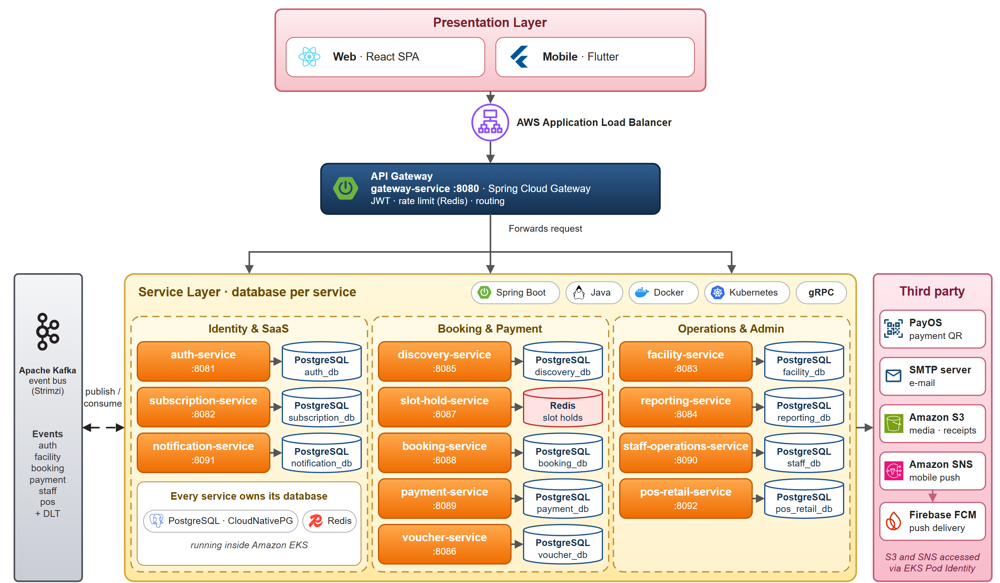

# fcourt-flutter



*Kiến trúc hệ thống FCourt*

Ứng dụng Android của FCourt, hệ thống đặt sân thể thao. Một app phục vụ bốn vai trò: khách hàng (khám phá chi nhánh, chọn slot, đặt sân và thanh toán, lịch sử đặt sân, đánh giá), chủ sân/admin (dashboard, chi nhánh, sân, slot template, lịch tuần, voucher, báo cáo), nhân viên (check-in bằng QR, đặt sân tại quầy, POS, check-in offline) và super admin (duyệt đơn đăng ký chủ sân). Push notification dùng Firebase Cloud Messaging.

Xây dựng bằng Flutter và Clean Architecture, chia theo feature. Android là nền tảng được hỗ trợ; các target `ios/` và `web/` chủ yếu dùng để review UI.

## Vai trò trong hệ thống FCourt

| Repo | Trách nhiệm |
|---|---|
| `fcourt-backend` | Các microservice Spring Boot mà app gọi qua HTTPS |
| `fcourt-web` | Web frontend (https://fcourt.donan.site) |
| **fcourt-flutter** (repo này) | Ứng dụng Android |
| `fcourt-gitops` | Manifest Argo CD triển khai backend lên EKS |
| `fcourt-infra` | Terraform cho AWS (VPC, EKS, ECR, S3, CloudFront, Route 53, ACM, ...) |

## Công nghệ

Flutter 3.47.7 (stable) với Dart 3.13.5, `flutter_bloc`, `dio`, `go_router`, `flutter_secure_storage`, `freezed`/`json_serializable`, `firebase_messaging`, `mobile_scanner`, `sqflite` (check-in offline), `workmanager`, `fl_chart`. Test dùng `bloc_test` và `mocktail`. Danh sách đầy đủ xem `pubspec.yaml`.

## Cấu trúc dự án

```text
fcourt-flutter
|- lib
|  |- main.dart            # entry point, khởi tạo AppDependencies
|  |- app                  # app.dart, router.dart, app_dependencies.dart, theme
|  |- core                 # config (AppConfig), error, network (Dio, AuthInterceptor), storage
|  |- features             # mỗi feature một thư mục: data / domain / presentation
|  |- src/features         # các feature khách hàng cũ hơn (discovery, slots, gallery)
|- test                    # unit test, bloc test và widget test
|- env                     # dev.json, prod.json (file dart-define, không chứa secret)
|- android, ios, web       # project theo từng nền tảng
|- tool                    # script ký bản release Android và test của chúng (Python)
|- .github                 # workflow, action setup-flutter, script
|- docs                    # tài liệu, xem docs/README.md
|- PRODUCT.md              # nguyên tắc sản phẩm và UX
```

Quy tắc phụ thuộc: `presentation -> domain <- data`. Cách thêm một feature: [lib/features/README.md](lib/features/README.md).

## Yêu cầu

- Flutter 3.47.7 (được pin trong `.github/actions/setup-flutter/action.yml`).
- Android Studio hoặc Android SDK, cùng một emulator hoặc thiết bị thật.
- Một backend: các service chạy local (xem `fcourt-backend`) hoặc bản đã deploy.
- `android/app/google-services.json` của project Firebase FCourt (Firebase Console, Project settings, Your apps, FCourt Android, Download). File này bị git-ignore; không bao giờ commit hay chia sẻ.

## Cài đặt, chạy, test

```bash
flutter pub get
flutter run --dart-define-from-file=env/dev.json     # backend local, nhìn từ emulator
flutter run --dart-define-from-file=env/prod.json    # backend đã deploy
```

| Lệnh | Mục đích |
|---|---|
| `flutter analyze --fatal-infos --fatal-warnings` | Phân tích tĩnh, nghiêm ngặt như CI |
| `flutter test` | Unit test, bloc test và widget test |
| `dart run build_runner build` | Sinh lại code freezed/json |
| `flutter build apk --debug --dart-define-from-file=env/dev.json` | APK debug (bước smoke build của CI) |
| `flutter run -d chrome --web-hostname=127.0.0.1 --web-port=18100 --dart-define=API_BASE_URL=http://127.0.0.1:18080` | Review UI trên trình duyệt; các tính năng native như camera, lưu ảnh vào gallery, push và offline cần Android |

Trên điện thoại thật, đặt `API_BASE_URL` trong bản `env/dev.json` ở máy bạn thành IP LAN của máy chạy backend và không commit thay đổi này. Bản debug cho phép HTTP cleartext; bản release chỉ cho phép HTTPS.

## Cấu hình

Cấu hình được đọc lúc build qua `--dart-define-from-file`. Các file env được commit, nên không được chứa secret.

| File | `API_BASE_URL` |
|---|---|
| `env/dev.json` | `http://10.0.2.2:8080` (máy host nhìn từ Android emulator), cùng URL riêng từng service cho các cổng 8082 đến 8085 |
| `env/prod.json` | điền `API_BASE_URL` của môi trường prod vào `env/prod.json` |

| Define | Ý nghĩa |
|---|---|
| `APP_ENV` | `dev` (mặc định) hoặc `prod` |
| `API_BASE_URL` | Base URL của gateway / API. Mặc định `http://10.0.2.2:8080` |
| `AUTH_BASE_URL`, `SUBSCRIPTION_BASE_URL`, `DISCOVERY_BASE_URL`, `FACILITY_BASE_URL`, `STAFF_BASE_URL`, `POS_BASE_URL`, `REPORTING_BASE_URL`, `VOUCHER_BASE_URL` | Ghi đè riêng từng service (tùy chọn) khi không có gateway chung; phần lớn fallback về `API_BASE_URL` |
| `SLOT_WEBSOCKET_URL` | URL WebSocket slot realtime (tùy chọn) |
| `GOOGLE_WEB_CLIENT_ID` | OAuth Web client ID cho đăng nhập Google (giá trị public). Phải trùng `AUTH_GOOGLE_CLIENT_ID` của auth service. OAuth client Android dùng package `com.bro73.fcourt` và SHA-1/SHA-256 của signing key. |

## CI/CD

- `.github/workflows/ci.yml`: job `changes` bỏ qua analyze/test với PR chỉ sửa docs; `analyze-and-test` chạy `flutter analyze --fatal-infos --fatal-warnings` và `flutter test`; `android-build` build APK debug với `google-services.json` giả khi file native, dependency hoặc `env/` thay đổi. Check bắt buộc: `analyze-and-test`, `android-build`, `signing-smoke`, `changes`.
- `.github/workflows/flutter-build-android.yml` ("Android release"): signing smoke trên các PR liên quan Android/tooling; khi push lên `main` thì build APK và AAB đã ký rồi upload dưới dạng Actions artifact (giữ 14 ngày). Không có gì được tự động publish lên store.
- Chốt chặn ký bản release: build release thất bại nếu thiếu upload keystore bên ngoài; debug key không bao giờ được dùng. Đầu vào, secret và cách kiểm tra nằm trong [docs/release/android-release.md](docs/release/android-release.md).
- `.github/scripts/retry-on-network-error.sh` chỉ retry khi tải về thất bại, không bao giờ retry khi test hoặc analyze thất bại.

## Kiểm thử

Chạy `flutter analyze` và `flutter test` trước mỗi PR (chạy lại sau khi merge `dev`, vì CI kiểm tra kết quả merge). Tooling ký bản release có test Python trong `tool/` (`python3 -m unittest discover -s tool -p 'test_*.py'`). Báo cáo QA thủ công và ghi chú validation theo từng task nằm trong [docs/qa](docs/qa) và [docs/validation](docs/validation); kết quả với fixture không phải là nghiệm thu tích hợp thực tế.

## Tài liệu

Xem [docs/README.md](docs/README.md): hướng dẫn feature theo từng task Jira, bằng chứng validation, báo cáo QA, release/ký và kế hoạch thực hiện.

## Đóng góp

- Branch: `main` (production), `dev` (tích hợp), `feat/<name>`, `fix/<name>`, `docs/<name>`.
- Commit và tiêu đề PR viết bằng tiếng Anh, `type(scope): message`, với scope là feature hoặc khu vực (ví dụ `fix(auth): handle expired refresh token`). Type: `feat`, `fix`, `docs`, `refactor`, `test`, `chore`.
- Mở PR vào `dev` với ít nhất một review và `analyze-and-test` xanh. Không push trực tiếp lên `main` hoặc `dev`.
- Không commit secret, token, file `.env`, keystore hay `google-services.json`.
