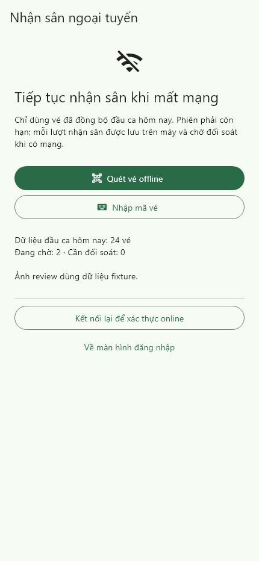

# SCRUM-116: cold-start and automatic recovery

2026-11-06, Flutter 3.47.7 / Dart 3.13.5, Windows.

After an online session-restore network failure, an Android employee may enter
the separate `/staff/offline` capability only with a current STAFF access token,
matching secure identity and a same-day SQLite snapshot no older than 12 hours.
Expired/premature tokens, other roles/accounts, stale dates and authorization
rejections fail closed. This is not an authenticated online session: router
guards prevent POS, administration, profile and online schedule access. Local
QR/manual preview does not wait for an online request before using cached data.

Reconnect/resume drains pending admissions before downloading a fresh snapshot.
Foreground polling retries the outbox every two seconds without HTTP when empty;
snapshot refresh runs every five minutes and failed shift downloads retry after
30 seconds. Pause/logout cancel timers; overlapping recovery is coalesced.
Snapshots preserve consumed tickets and pending commands. Returning online still
requires the ordinary server-verified session restore.

Validation: analyzer clean; 609 tests pass. Coverage includes real SQLite reopen,
cache freshness/day/scope, token expiry/role/not-before checks, authorization and
router denial, stale asynchronous session results, foreground retry/lifecycle
timers, manual local admission, large text, narrow/tablet and dark layouts.

The screenshot shows the actual entry page with fixture sync counts. No physical
Android device or deployed gateway was available. Native camera/flash, Keystore,
airplane-mode/process-kill and background scheduling remain device acceptance;
neither the timer tests nor Workmanager establish a three-second completion SLA.
