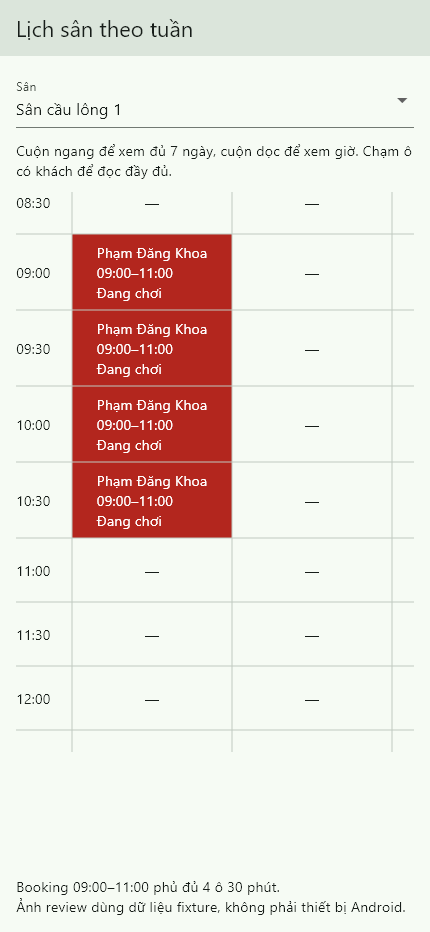

# SCRUM-64: complete booking spans

2026-11-06, Flutter 3.47.7 / Dart 3.13.5, Windows.

The weekly matrix indexes every 30-minute cell overlapped by a booking, rather
than only its start. A 09:00–11:00 booking occupies four cells; 11:00 remains
available for the next session. Status, customer details and authority warning
flags remain attached to every occupied cell. Midnight belongs to the correct day.

Validation: analyzer clean; all 594 tests pass. New domain and widget tests cover
multi-slot duration, partial overlaps, adjacent boundaries, midnight and reading
details from a continuation cell. Existing warning and scrolling tests pass.

The screenshot uses current widgets and fixture data at 430×932. Device scrolling
performance remains a physical Android acceptance check.
